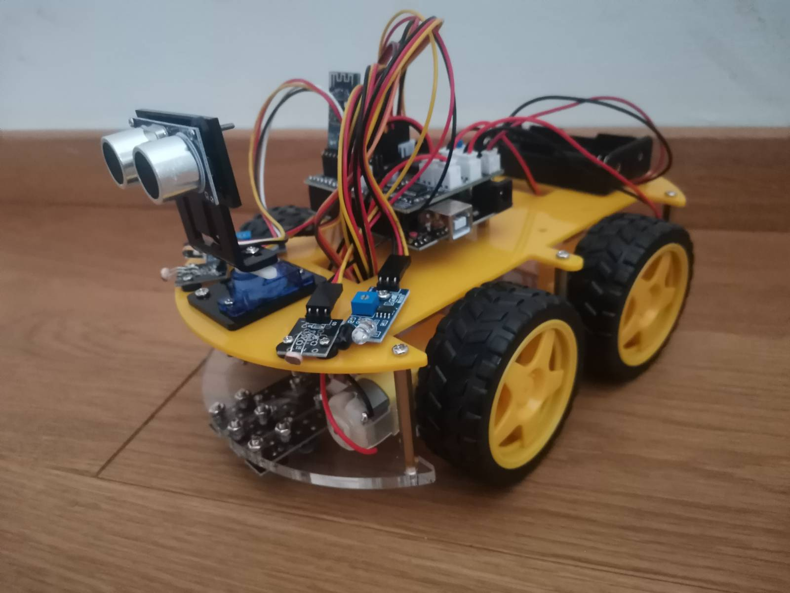
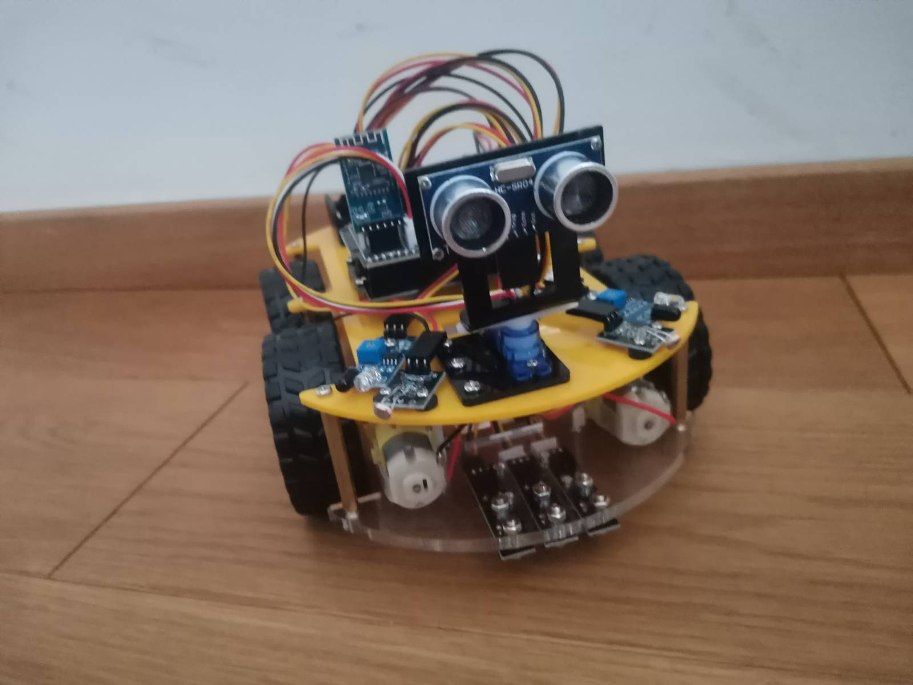
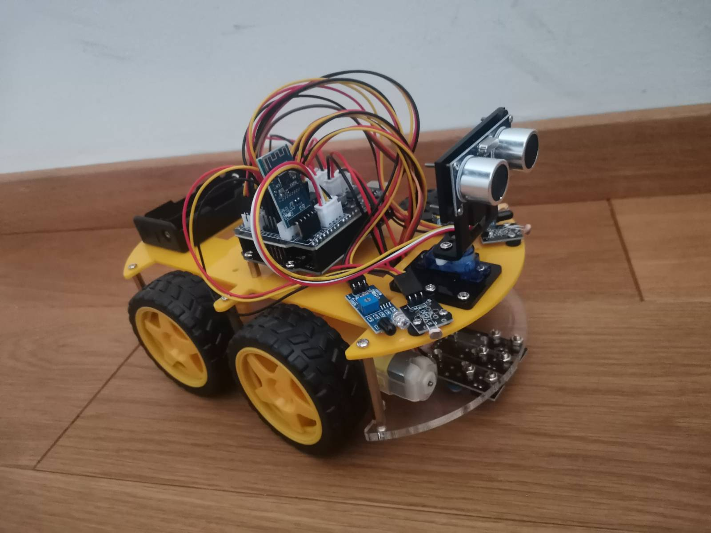
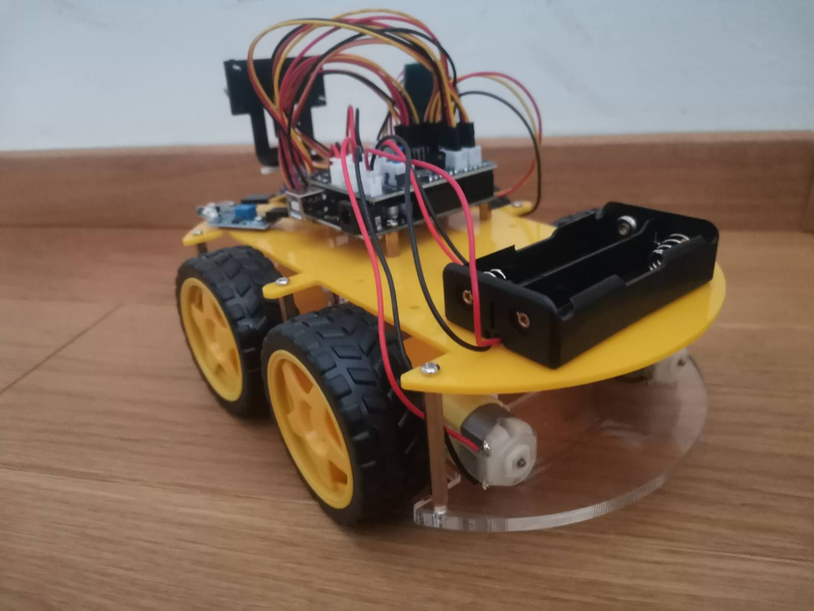

# 🤖 My First Robot: A Father & Son Journey

> Building dreams, one component at a time

---

## 📖 About

My son's first steps into robotics, at just 6 years old! 🎉

We're building a **Bluetooth-controlled 4WD robot car** from scratch using the **LAFVIN Arduino robot car kit**. This repository documents our learning process, experiments and all the little victories along the way.

**Why we're doing this:**
- 🧠 Learn electronics and programming together
- 🔧 Develop problem-solving skills
- 👨‍👦 Quality father-son time
- 🚀 Inspire other young makers

---

## 🎯 Roadmap

- [x] Unbox and organize components
- [x] Set up Arduino IDE
- [x] Find the pins for every motor and sensor (systematic testing)
- [x] Drive all four wheels forward and backward
- [x] Ultrasonic sensor and servo "radar" scan
- [x] Bluetooth control (F / B / L / R / S)
- [ ] Autonomous obstacle avoidance
- [ ] Follow-me mode
- [ ] Line tracking (we need to build a track first!)
- [ ] Speed control and a custom phone app

---

## 🛠️ Hardware

| Part | Qty | Notes |
|------|-----|-------|
| Arduino UNO R3 | 1 | Main board |
| L298N motor driver | 1 | 2 channels: left pair and right pair |
| HC-05 Bluetooth module | 1 | Wireless control |
| DC motors | 4 | Wheels are driven in pairs |
| HC-SR04 ultrasonic sensor | 1 | Distance measuring |
| Servo motor | 1 | Turns the sensor for radar scans |
| Chassis, wheels, battery holder | 1 set | From the kit |

### Pin map

| Function | Pin |
|----------|-----|
| Left motors PWM (speed) | 5 |
| Right motors PWM (speed) | 11 |
| Ultrasonic TRIG | 12 |
| Ultrasonic ECHO | 13 |
| Servo | 10 |
| Bluetooth | Serial (9600 baud) |

> Direction pins for the motors are documented in [`Test_Pins_And_Components`](Test_Pins_And_Components/README.md).

### Bluetooth commands

The HC-05 talks to the Arduino over Serial at 9600 baud. Send a single character from the phone app:

| Command | Action |
|---------|--------|
| `F` | Forward |
| `B` | Backward |
| `L` | Turn left |
| `R` | Turn right |
| `S` | Stop |

<!-- TODO: add a wiring diagram (Fritzing export), e.g. images/wiring.png -->

---

## 💻 Software

- **Arduino IDE**, language: Arduino (C/C++)
- **Phone app:** a Bluetooth RC controller app (custom app TBD)

### Setup

1. Download the [Arduino IDE](https://www.arduino.cc/en/software)
2. Install the USB driver for the Arduino UNO
3. **Tools → Board → Arduino UNO**, then select your port under **Tools → Port**
4. Open a sketch from [`Test_Pins_And_Components`](Test_Pins_And_Components/) and click **Upload**

> Tip: if the HC-05 is connected to the RX/TX pins (0 and 1), unplug it while uploading, otherwise the upload can fail.

---

## 🧪 What's in this repo

| Folder | What's inside |
|--------|---------------|
| [`Test_Pins_And_Components`](Test_Pins_And_Components/) | Test sketches we used to find the right pins, plus the full story of how we did it |
| [`images`](images/) | Photos of our progress |

Highlights from the tests:

- `Test_Donji_Levi_Napred.ino` tries every PWM and direction pin combination automatically. It saved our sanity.
- `Test_Unazad-Finalno.ino` drives all four wheels backward.
- `Test_Radar_Hunting_Mode.ino` sweeps the servo, finds the closest object and measures it.

---

## 📚 Lessons learned

- Don't assume pins are standard. Test them.
- Be systematic: test every combination, write down the results, and add pauses so you can see what happens.
- The motor driver has only two channels, so wheels can only be controlled as a left pair and a right pair.

Read the full story in [`Test_Pins_And_Components/README.md`](Test_Pins_And_Components/README.md).

---

## 📸 Gallery

| | |
|---|---|
|  |  |
|  |  |

<!-- Add a short GIF of the robot driving: images/demo.gif -->

---

## 🎓 What we're learning

**My 6-year-old:** how electricity works, following instructions, patience, and cause and effect (code → robot action).

**Dad:** teaching electronics to a young child, breaking down complex ideas, Arduino programming, and being patient with tiny fingers and big questions!

---

## 🤝 Contributing

Ideas and tips for young makers are very welcome. Open an issue or a pull request!

## 📄 License

MIT. See [LICENSE](LICENSE).
